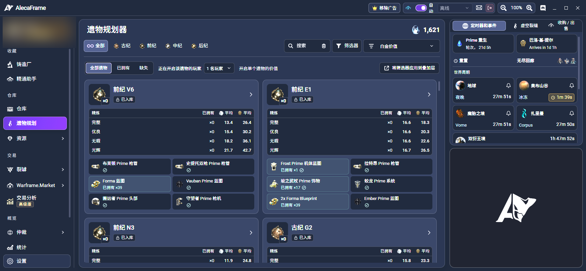
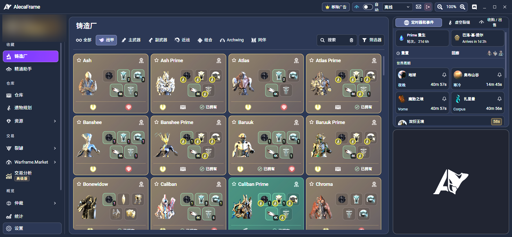
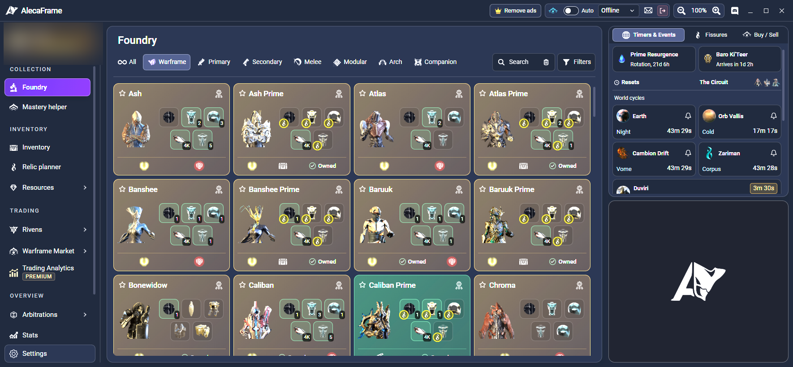

# AlecaFrame 简体中文补丁（AlecaFrame-ZH）

给 Overwolf 应用 **AlecaFrame** 增加简体中文界面，并让物品名（武器 / MOD / 赋能 / 资源 / 遗物 / Prime 部件）按游戏官方简中显示。

- 非官方、开源的本地化补丁；通过“运行时注入”实现，**不修改官方安装包、签名或 DLL**
- 支持**随时开启 / 随时取消**（中文启动、恢复英文、会话内快速切换）
- 支持**多台电脑部署**（整个文件夹拷走即可，自动定位 Overwolf 与 AlecaFrame 版本）
- 词库约 **2 万条**（UI 文案 + 18,778 条物品名），可自行维护



---

## ⚠️ 重要声明（务必先读）

1. 本项目为**非官方**汉化补丁，与 AlecaFrame 作者、Overwolf、Digital Extremes 均无关联。
2. 实现方式是：启动 Overwolf 时传入参数关闭扩展完整性校验（`--ow-disable-features=extension-validation,...` + `--ow-enable-features=force-validation-report-only`），再注入翻译脚本。这**违反 Overwolf 平台条款** 7.2(ii)（禁用安全特性）/ 7.2(iii)（派生作品）。使用即表示你自行承担被平台限制、升级失效等风险，**不建议公开分发或商业使用**。
3. 补丁只修改 AlecaFrame 的前端页面，**不修改 Warframe 游戏文件**；DE 对第三方软件的政策是“自担风险（at your own risk）”。
4. 本仓库**不包含任何 AlecaFrame 源码**（其版权归作者所有），仅包含本项目自己的脚本、词典与文档。

---

## ✨ 特性

| 功能 | 说明 |
|---|---|
| 界面汉化 | 主窗口、侧栏、设置、遗物规划、裂罅、统计、MOD 规划、仲裁等页面 |
| 物品名汉化 | 武器、MOD、赋能、资源、遗物、Prime 部件；**战甲名保留英文** |
| 动态文本 | 数字/日期/数量前缀等模板规则翻译（如 `223 recorded days` → `223 天已记录`） |
| 一键开关 | `Start`（中文）/ `Restore`（英文）/ `Toggle`（会话内切换） |
| 多机部署 | 自动查找 Overwolf 安装路径与扩展版本，无需改路径、无需管理员权限 |
| 可维护 | 词典为纯文本 TSV；构建脚本可再生成运行时 JS |

对比截图：

| 中文 | English |
|---|---|
|  |  |

---

## 🚀 快速开始（普通用户）

> 需要先安装 [Overwolf](https://www.overwolf.com/) 和官方 **AlecaFrame**，并打开一次（让 `PackagesCache` 与 `Extensions` 目录生成）。

1. 从本仓库的 **Releases** 下载最新 `AlecaFrame-ZH-v*.zip`；
2. 解压到任意本地目录（例如 `D:\AlecaFrame-ZH`）；
3. 双击 `Install-Shortcuts.cmd`（桌面生成 3 个快捷方式）；
4. 以后：
   - **AlecaFrame-ZH Start**：中文模式启动（会重启 Overwolf）；
   - **AlecaFrame-ZH Restore**：恢复英文原版；
   - **AlecaFrame-ZH Toggle**：在中文会话内快速切换中/英（不重启 Overwolf）。

> 如果启动后仍是英文：看 `logs\launcher.log`；如果 AlecaFrame 打不开：先运行 **Restore**，再运行 **Start**。

---

## 🛠 从源码构建

环境：Windows + PowerShell 5.1 + [Python 3](https://www.python.org/)。

```powershell
# 1) 生成运行时脚本 bin/alecaframe-zh-cn.js（需要 src/vendor/translations.zh-CN.json）
python src\build.py

# 2) 如需根据本机游戏数据重新生成物品名对照（可选）
python src\build_items.py

# 3) 打包发布 zip（可选）
python scripts\package.py
```

构建产物：`bin/alecaframe-zh-cn.js`（约 860 KB，词典 + 翻译层）。

> `bin/alecaframe-zh-cn.js` 是生成文件，已在 `.gitignore` 中忽略；发布 zip 时由构建步骤生成。
> 启动器 `bin/AlecaFrame-ZH.ps1` 含中文，**必须保持 UTF-8 with BOM** 保存，否则 Windows PowerShell 5.1 会乱码报错。

---

## 📁 目录结构

```
AlecaFrame-ZH/
├─ Start-Chinese.cmd / Restore-English.cmd / Toggle-Chinese.cmd
├─ Refresh-Chinese.cmd / Status.cmd / Install-Shortcuts.cmd
├─ bin/
│  └─ AlecaFrame-ZH.ps1          启动器（还原官方文件 -> 带参启动 -> 注入 -> 重载）
├─ dict/
│  ├─ items.tsv                  物品名对照（自动生成，18,778 条）
│  ├─ extra-1..7.tsv             UI 文案词库（人工维护）
│  └─ fixes.tsv                  覆盖上游机翻错误
├─ src/
│  ├─ engine.js                  运行时翻译层（DOM 遍历 + MutationObserver + 规则）
│  ├─ build.py                   合并词库 -> bin/alecaframe-zh-cn.js
│  ├─ build_items.py             从游戏数据生成 dict/items.tsv
│  └─ vendor/translations.zh-CN.json  上游词库（MIT，见 NOTICE）
├─ docs/
│  ├─ 维护手册.md                完整维护文档（强烈建议维护者阅读）
│  ├─ 可行性评估.md              早期技术调研存档
│  └─ images/                    截图
├─ scripts/build.ps1 / package.py
└─ .github/workflows/            CI：构建校验 + tag 发布
```

---

## 🧩 工作原理

```
Start-Chinese.cmd
  1) 关闭 Overwolf
  2) 从官方 app.opk 还原 10 个前端页面
  3) 带参数启动 Overwolf（关闭扩展完整性校验，仅本次会话）
  4) 注入 <script src="assets/js/alecaframe-zh-cn.js">，只重启 AlecaFrame 渲染进程
```

- `alecaframe-zh-cn.js` 遍历 DOM 文本节点/属性做精确匹配替换，MutationObserver 持续处理 Vue 动态渲染；
- 数字/日期等模板由 `src/engine.js` 内的规则处理；
- 词典优先级：`items.tsv` → 上游词库 → `fixes.tsv` → `extra-*.tsv`（后者覆盖前者）。

---

## 🔄 版本更新与兼容性

- AlecaFrame / Overwolf 更新后，补丁可能需要适配（本机曾观察到 12 小时内小版本更新）。
- 更新后先运行一次 **Start**：脚本会自动选择最新版本目录并从该版本 `app.opk` 还原、重新注入。
- 若出现 `HashMismatch` 或 AlecaFrame 打不开：说明校验参数失效或页面结构大改，参见 [维护手册](docs/维护手册.md) 第 6 节。
- 已适配基线：AlecaFrame `3.0.6` / Overwolf `0.311.1.6`（2026-11）。

---

## ❓ FAQ

**Q：会封号吗？**
只改 AlecaFrame 前端，不碰游戏文件；DE 政策为“第三方软件自担风险”。理论上风险低，但不是零风险。

**Q：为什么战甲名还是英文？**
按需求刻意保留（Ash、Wukong Prime 等），但战甲部件会显示为 `Wukong Prime 机体蓝图` 的混合形式。

**Q：为什么有的物品名仍是英文？**
游戏数据缺少该物品的简中名（例如部分非 Prime 部件），或属于节点名/裂罅生成名/阵营名。

**Q：更新后中文没了怎么办？**
运行 `Start-Chinese.cmd`。仍不行看 `logs\launcher.log`，或 `Restore` 后重试。

---

## 📤 上传到 GitHub（首次）

本仓库已整理为可直接托管的源码结构（`.gitignore` 已排除构建产物与本机数据）。

```bash
cd AlecaFrame-ZH
git init
git add .
git commit -m "init: AlecaFrame-ZH v1.0.0"
git branch -M main
git remote add origin https://github.com/<你的用户名>/AlecaFrame-ZH.git
git push -u origin main
```

发布新版本：

```bash
# 改 VERSION / CHANGELOG 后
git tag v1.0.1
git push origin v1.0.1   # 触发 release workflow，自动构建 zip 并创建 Release
```

> 如果你在网页端拖拽上传：网页上传**不会**读取 `.gitignore`，请手动排除 `bin/alecaframe-zh-cn.js`、`dist/`、`state/`、`logs/`、`backup/`、`verify/`。
> 推荐使用 Git for Windows 或 GitHub Desktop 管理。

---

## 🙏 致谢与许可

- 本项目代码：MIT License（见 [LICENSE](LICENSE)）。
- 上游词库 `src/vendor/translations.zh-CN.json` 来自社区项目 [MIOEU/AlecaFrame-ZH](https://github.com/MIOEU/AlecaFrame-ZH)（MIT）与 [191086215333/AlecaFrame-ZH-](https://github.com/191086215333/AlecaFrame-ZH-)（MIT），详见 [NOTICE.md](NOTICE.md)。
- 物品中英文名来自 AlecaFrame 本地游戏数据与 Warframe 官方本地化，版权归 Digital Extremes；仅用于第三方工具的中文显示。
- AlecaFrame © Alejandro Cabrerizo，All rights reserved；本项目不包含其源码。
- 参考：Overwolf 平台条款、DE 第三方软件政策、Warframe 中文 Wiki。

---

## 📌 免责声明

本项目仅供学习与个人使用。因使用本补丁导致的账号、平台或软件问题，作者不承担任何责任。若你不同意上述条款，请勿使用。
