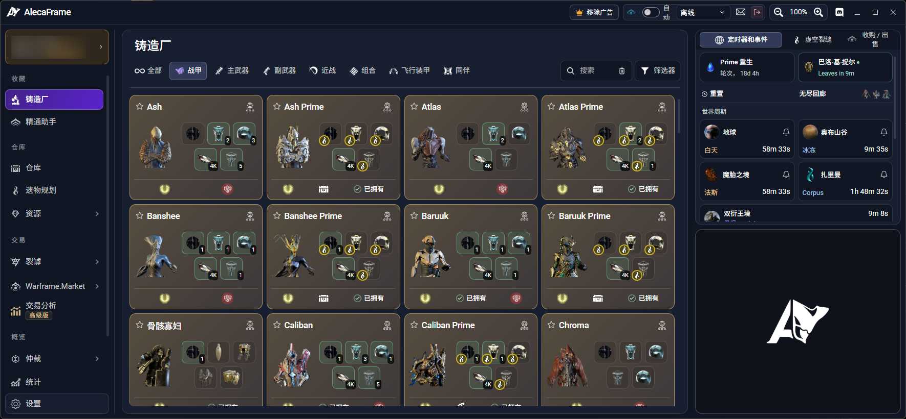
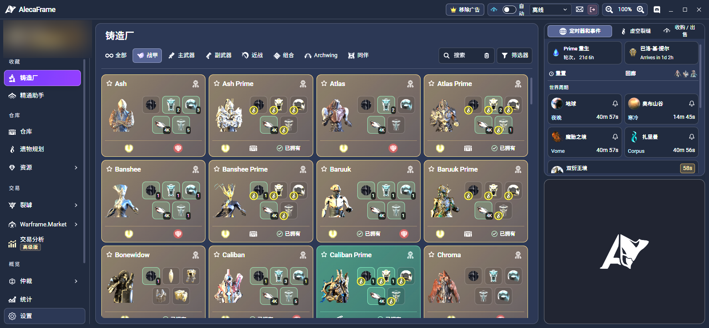
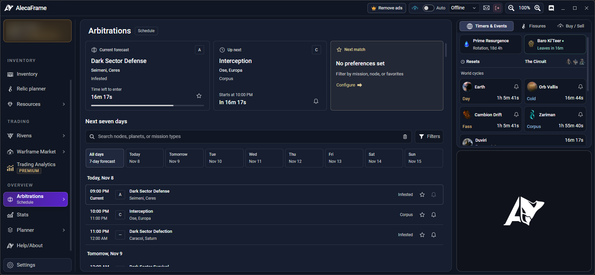

# AlecaFrame 简体中文补丁（AlecaFrame-ZH）

给 Overwolf 应用 **AlecaFrame** 增加简体中文界面，并让物品名（武器 / MOD / 赋能 / 资源 / 遗物 / Prime 部件）按游戏官方简中显示。

- 非官方、开源的本地化补丁；通过“运行时注入”实现，**不修改官方安装包、签名或 DLL**
- 支持**随时开启 / 随时取消**（中文启动、恢复英文、会话内快速切换）
- 支持**多台电脑部署**（整个文件夹拷走即可，自动定位 Overwolf 与 AlecaFrame 版本）
- 可选 **中文搜索**（仓库/铸造厂/遗物规划器/WFM 列表/市场搜索框可直接输中文）
- 可选 **中文 OCR 增强**（遗物推荐、遗物奖励、裂罅识别在中文界面下也能工作）



---

## ⚠️ 重要声明（务必先读）

1. 本项目为**非官方**汉化补丁，与 AlecaFrame 作者、Overwolf、Digital Extremes 均无关联。
2. 实现方式是：启动 Overwolf 时传入参数关闭扩展完整性校验（`--ow-disable-features=extension-validation,...` + `--ow-enable-features=force-validation-report-only`），再注入翻译脚本。
3. 补丁只修改 AlecaFrame 的前端页面，**不修改 Warframe 游戏文件**；DE 对第三方软件的政策是“自担风险（at your own risk）”。
4. 本仓库**不包含任何 AlecaFrame 源码**（其版权归作者所有），仅包含本项目自己的脚本、词典与文档。
5. 中文 OCR 是**可选组件**：会在项目目录内下载 Python / Node / PaddleOCR 与中文模型（数百 MB），不装也能正常使用界面汉化与中文搜索。

---

## ✨ 特性

| 功能         | 说明                                                    |
| ---------- | ----------------------------------------------------- |
| 界面汉化       | 主窗口、侧栏、设置、遗物规划、裂罅、统计、MOD 规划、仲裁、市场、小队等页面               |
| 物品名汉化      | 武器、MOD、赋能、资源、遗物、Prime 部件；**战甲名保留英文**                  |
| 动态文本       | 数字/日期/数量前缀等模板规则翻译（如 `223 recorded days` → `223 天已记录`） |
| 中文搜索       | 仓库 / 铸造厂 / 遗物规划器 / WFM 列表 / 市场搜索：输入中文自动转成英文查询再本地过滤    |
| 中文 OCR（可选） | 中文界面下遗物推荐、遗物奖励、裂罅界面仍能识别（官方 OCR 只认英文）                  |
| 一键开关       | 中文/ 英文/ 会话内切换                                         |
| 可维护        | 词典为纯文本 TSV；构建脚本可再生成运行时 JS；有 CI 与词条校验                  |

对比截图：

| 中文                                | English                                |
| --------------------------------- | -------------------------------------- |
|  |  |

---

## 🚀 快速开始（普通用户）

> 需要先安装 [Overwolf](https://www.overwolf.com/) 和官方 **AlecaFrame**，并打开一次（让 `PackagesCache` 与 `Extensions` 目录生成）。

1. 从本仓库的 **Releases** 下载最新 `AlecaFrame-ZH-v*.zip`；
2. 解压到任意本地目录（例如 `D:\AlecaFrame-ZH`）；
3. 双击 `创建桌面快捷方式.cmd`（桌面生成 3 个快捷方式）；
4. （可选）双击 `安装OCR前置组件.cmd` 装中文 OCR；
5. 以后：
   - **AlecaFrame 中文版（启动）**：中文模式启动（会重启 Overwolf）；
   - **AlecaFrame 英文版（恢复）**：恢复英文原版（会重启 Overwolf）；
   - **AlecaFrame 中英切换（不重启）**：在中文会话内快速切换中/英（只重载 AlecaFrame）。

> 如果启动后仍是英文：看 `logs\launcher.log`

### 中文 OCR（可选增强）

| 操作 | 命令 |
|---|---|
| 安装前置（一次性，需联网） | `安装OCR前置组件.cmd` |
| 开启（默认开） | `启用中文遗物OCR.cmd` |
| 关闭（保留界面汉化） | `关闭中文遗物OCR.cmd` |

- OCR 前置装在 `bin\ocr\.tools\`（便携 Python + Node + PaddleOCR 模型），**不修改系统全局环境**；
- 首次识别时 Paddle 模型要加载，可能失败一次后正常（冷启动最长约 2 分钟）；
- 不装前置也能用界面汉化与中文搜索，启动器会自动跳过 OCR 并在日志里提示。

---

## 🧩 工作原理

```
Start-Chinese.cmd
  1) 关闭 Overwolf
  2) 从官方 app.opk 还原页面（含 OCR 改写的 relicOverlay/main.js）
  3) 带参数启动 Overwolf（关闭扩展完整性校验，仅本次会话）
  4) 注入 <script src="assets/js/alecaframe-zh-cn.js">，只重启 AlecaFrame 渲染进程
  5) 若启用 OCR：先起本地 OCR 服务（127.0.0.1:38147），再注入各页面的 OCR 桥/叠加层
```

- `alecaframe-zh-cn.js` 遍历 DOM 文本节点/属性做精确匹配替换，MutationObserver 持续处理 Vue 动态渲染；
- 中文搜索模块建立“中文 -> 英文”反向索引，输入中文时把英文查询字段清空、取回完整列表后本地过滤；
- 数字/日期等模板由 `src/engine.js` 内的规则处理；
- 词典优先级：`items.tsv` → `mioeu-terms.tsv` → 上游词库 → `fixes.tsv` → `extra-*.tsv`（后者覆盖前者）。

---

## 🐞 出问题时怎么报

双击 **`导出诊断包.cmd`**，会在桌面生成 `AlecaFrame-ZH-Diagnostics-<时间>.zip`，把这个 zip 发给维护者即可。它只**读取**不修改，包含：

| 内容 | 说明 |
|---|---|
| `env.txt` | 系统版本、Overwolf/AlecaFrame 版本、注入状态、charset 是否补上、OCR 组件与模型、快捷方式 |
| `status.txt` | `Status.cmd` 的输出（汉化状态 / 会话参数 / OCR 开关） |
| `injection.txt` | 10 个页面各自注入了哪些脚本、是否声明 UTF-8 |
| `logs/` | `launcher.log`、`ocr-install.log`、OCR 运行日志、上次会话状态 |
| `overwolf/` | Overwolf 自己的窗口日志尾部（含扩展加载/校验信息） |

> 日志里可能含 Warframe 用户名、Warframe.Market 用户名；token/密码/邮箱已做粗略打码，回传前可自行检查。

常见故障的排查顺序：`Status.cmd` → `logs\launcher.log` → `导出诊断包.cmd`。

---

## ❓ FAQ

**Q：会封号吗？**
只改 AlecaFrame 前端，不碰游戏文件；DE 政策为“第三方软件自担风险”。理论上风险低，但不是零风险。

**Q：为什么战甲名还是英文？**
按需求刻意保留（Ash、Wukong Prime 等），但战甲部件会显示为 `Wukong Prime 机体蓝图` 的混合形式。

**Q：为什么有的物品名仍是英文？**
游戏数据缺少该物品的简中名，或属于节点名/裂罅生成名/阵营名；剩余未覆盖清单见 `dict/gap-candidates.tsv`。

**Q：中文搜索搜不到怎么办？**
先确认 `bin\alecaframe-zh-cn.js` 是最新的（`python src\build.py`），并在 `Status.cmd` 里确认当前是中文会话；搜索只在中文会话注入的页面里生效。

**Q：OCR 开了但遗物/裂罅不显示中文？**
按顺序排查：`安装OCR前置组件.cmd` 是否成功 → `bin/ocr/afzh-items.js` 是否存在（跑 `python src\build.py`）→ `Status.cmd` 看缺失项 → `state\RelicChineseOcr\helper.err.log`。

**Q：更新后中文没了怎么办？**
运行 `Start-Chinese.cmd`。仍不行看 `logs\launcher.log`，或 `Restore` 后重试。


---

## 📌 免责声明

本项目仅供学习与个人使用。因使用本补丁导致的账号、平台或软件问题，作者不承担任何责任。若你不同意上述条款，请勿使用。
